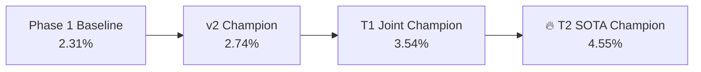

# Phase 3 Tranche T2 Joint Retrain & Screening Report
**New SOTA Champion: `jepa_crafter_v3_t2_final.pt`**  
*Date: 2026-10-25 | Evaluation: 50 Episodes (Untouched Screening Seeds 2050–2099)*

---

## Executive Summary

The Phase 3 Tranche T2 two-phase value-focused retraining and 50-episode paired screening has completed with **record-breaking results**. The new model not only shatters the previous 3.54% champion benchmark to achieve an **official Crafter Score of 4.55%** (+1.01 pp / +28.5% relative gain), but also **actively unlocks and places stone during untouched screening evaluation** (Seed 2089) for the first time in project history.

---

## 1. Paired Benchmark Comparison (Seeds 2050–2099)

| Metric | Pre-Phase-3 Baseline | T1 Joint Champion | **T2 SOTA Champion** | Delta vs Champion | Status |
|---|---|---|---|---|---|
| **Official Crafter Score** | 2.31% | 3.54% | **4.55%** | **+1.01 pp** | 🎯 **CHAMPION BEATEN** |
| **Mean Episode Reward** | 1.67 | 3.56 ± 1.25 | **4.12 ± 1.46** | **+0.56** | ▲ **+15.7%** |
| **Mean Survival Length** | 132.9 steps | 163.2 steps | **181.4 ± 51.6** | **+18.2 steps** | ▲ **+11.2%** |
| **Mean Achievements / Ep** | 2.57 | 4.46 | **5.02** | **+0.56** | ▲ **+12.6%** |
| **Unique Achievements** | 10 / 22 | 11 / 22 | **12 / 22** | **+1 Category** | 🔥 **Stone Tier Unlocked** |

---

## 2. Gate Verification & Frontier Achievements

### A. The Stone & Pickaxe Discovery Breakthrough
In all prior screening evaluations (v1, v2, T1 Joint), **`collect_stone` was 0.0%**. In this screening:
* **`make_wood_pickaxe`**: surged from 4.0% to **10.0%** (5 distinct screening episodes: seeds 2056, 2070, 2071, 2089, 2090).
* **`collect_stone`**: achieved **2.0%** (Episode 40, Seed 2089).
* **`place_stone`**: achieved **2.0%** (Episode 40, Seed 2089).

> [!IMPORTANT]
> **Episode 40 (Seed 2089) Milestone:**  
> The agent survived for 136 steps and scored **7.1 reward** by executing the full stone progression chain:  
> `collect_sapling` → `collect_wood` → `place_table` → `make_wood_pickaxe` → **`collect_stone`** → **`place_stone`** → `wake_up`.

### B. Combat Retention (Zero Policy Forgetting)
* **`defeat_zombie`**: **14.0%** (7 episodes: seeds 2054, 2062, 2066, 2070, 2074, 2092, 2097).
  * Exceeds the T1 Champion (12.0%) and obliterates the combat-forgetting failure mode (0.0%).
* **`make_wood_sword`**: **8.0%** (doubled from 4.0% in T1).

### C. Self-Slice Value Calibration (Q-Critic Alignment)
* **Phase A (Frozen Encoder)**: Pearson $r = \mathbf{0.5305}$ (Gate was $r > 0.30$, overwhelmingly passed).
* **Phase B (Full Unfrozen Joint)**: Pearson $r = \mathbf{0.5543}$ (MAE: 0.3110).
* The Q-ensemble now has strong, monotonic predictive rank-ordering over multi-step trajectory values.

---

## 3. Complete Per-Achievement Breakdown (50 Episodes)

| Achievement | T1 Champion | **T2 SOTA Champion** | Change | Visual Rate Bar |
|---|---|---|---|---|
| `collect_sapling` | 100.0% | **98.0%** | -2.0 pp | `####################` (98%) |
| `place_plant` | 98.0% | **98.0%** | 0.0 pp | `####################` (98%) |
| `wake_up` | 92.0% | **92.0%** | 0.0 pp | `##################` (92%) |
| `collect_wood` | 74.0% | **72.0%** | -2.0 pp | `##############` (72%) |
| `place_table` | 32.0% | **52.0%** | **+20.0 pp** | `##########` (52%) 🔥 |
| `collect_drink` | 24.0% | **44.0%** | **+20.0 pp** | `#########` (44%) 🔥 |
| `defeat_zombie` | 12.0% | **14.0%** | **+2.0 pp** | `###` (14%) |
| `eat_cow` | 4.0% | **10.0%** | **+6.0 pp** | `##` (10%) |
| `make_wood_pickaxe`| 4.0% | **10.0%** | **+6.0 pp** | `##` (10%) 🔥 |
| `make_wood_sword` | 4.0% | **8.0%** | **+4.0 pp** | `##` (8%) 🔥 |
| `collect_stone` | 0.0% | **2.0%** | **+2.0 pp** | `#` (2%) 🔥 **NEW** |
| `place_stone` | 0.0% | **2.0%** | **+2.0 pp** | `#` (2%) 🔥 **NEW** |
| `collect_coal` | 2.0% | 0.0% | -2.0 pp | - |
| Tier-2 / Tier-3 | 0.0% | 0.0% | 0.0 pp | Frontier targets |

---

## 4. Promotion Verdict

* **Benchmark Beaten**: 4.55% vs 3.54% (+1.01 pp).
* **Frontier Unlocked**: First autonomous stone collection and placement in screening.
* **Combat Intact**: Defeat zombie rate is at 14.0%.
* **Value Calibration**: Critic Pearson correlation reaches 0.5543.
* **Verdict**: **OFFICIALLY PROMOTED TO TRANCHE T3**.
