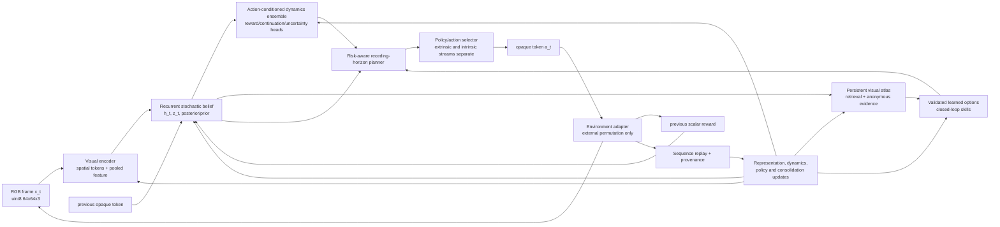

# MOSAIC — Research-Validated Architecture Specification

- **Working name:** MOSAIC — Persistent Visual Skill Atlas
- **Research checkpoint:** 2026-11-04
- **Status:** provisional architecture hypothesis; specification first, implementation pending staged validation
- **Primary environment:** Crafter, visual-only control
- **Normative companion records:** [`MOSAIC_Evidence_Ledger.md`](MOSAIC_Evidence_Ledger.md) and [`MOSAIC_Decision_Ledger.md`](MOSAIC_Decision_Ledger.md)

## 0. Executive decision

MOSAIC is a **recurrent stochastic visual predictive agent with an anonymous, persistent skill atlas**. It combines:

1. spatial visual tokens and a recurrent belief state;
2. action-conditioned latent dynamics with calibrated uncertainty;
3. active probing that values information while respecting survival and returnability;
4. persistent episodic memory plus replay-based consolidation;
5. learned closed-loop skills promoted only after reliability tests; and
6. receding-horizon planning over retrieved trajectories and learned skills, with primitive control as fallback.

This is the strongest current research direction, not a claim that every component is necessary or already effective. A strong recurrent and object-centric PPO baseline must be measured first. Each additional component is promoted only when it clears a pre-registered gate against that baseline and its simpler predecessor.

MOSAIC must never use privileged environment state, semantic action names, hand-authored game rules, recipe/affordance tables, true achievement arrays, or evaluator metadata in the decision loop. Relations are anonymous learned hypotheses supported by visual evidence and controlled interaction. Material or progression gating remains disabled until learned extraction and validation have passed their own gates.

## 1. Scope, goals, and non-goals

### 1.1 Goals

- Learn from RGB observations, scalar previous reward, public step count, and the agent's own action history.
- Discover action-conditioned visual effects and retain useful discoveries across episode resets.
- Improve breadth and depth of Crafter competence under a fixed environment-step and wall-clock budget.
- Separate task competence from information-seeking incentives.
- Make uncertainty, provenance, contradictions, and failure boundaries inspectable.
- Transfer useful visual dynamics, route fragments, and options to held-out seeds and appearances.
- Keep the implementation compatible with a single T4-class experiment after profiling.

### 1.2 Non-goals

- Reconstructing or importing Crafter's internal simulator state.
- Encoding human knowledge of action meanings, terrain, costs, prerequisites, or crafting relations.
- Declaring success from latent prediction loss, a single aggregate score, or one successful trajectory.
- Making an LLM, language planner, or evaluator the control authority.
- Starting with a large hierarchy before primitive competence and representation validity are measured.

### 1.3 Research status vocabulary

The specification uses the ledger vocabulary:

- **Verified-local:** directly inspected or executed in this checkout/runtime.
- **Repository-reported:** recorded by project artifacts but not reproduced here.
- **Primary-source:** stated by a cited paper or official implementation.
- **Reasoned:** an engineering implication requiring an experiment.
- **Unknown:** not established by current evidence.

The evidence and decision ledgers are the source of truth for claims and objections. This document is the architecture and experiment contract built from them.

## 2. Repository audit and starting point

### 2.1 Canonical AEON baseline

The canonical package is `AEON/jepa-crafter`.

| Area | Current verified state | Consequence for MOSAIC |
|---|---|---|
| Observation boundary | `CrafterAdapter` sanitizes observations to `uint8 [64,64,3]`, returns scalar reward and termination flags, and removes `info` from learner data. | Preserve this boundary and audit every new path. |
| Action boundary | The learner emits one of 17 opaque tokens; `OpaqueActionMapping` translates tokens outside the learner. | Keep tokens anonymous and the per-run permutation outside the model. |
| Encoder | Three convolutional stages produce a spatial `8x8` grid of 128-dimensional tokens plus attention pooling. | Reuse as a baseline; test object-centric/grid alternatives rather than assuming them. |
| Temporal model | A GRU consumes pooled visual features and action embeddings. | Upgrade to a stochastic belief model only after the GRU baseline is measured. |
| Dynamics | Three transformer predictor members perform action-conditioned latent prediction. | Retain as the first uncertainty baseline; test calibration and correlated-member failure. |
| Target path | EMA target encoder and masked cosine latent loss. | Add an information anchor or decoder only through a collapse/information ablation. |
| Auxiliary heads | Reward and termination predictions exist. | Extend with separate task/information value streams after baseline validation. |
| Replay | Raw uint8 frames, episode IDs, timesteps, transition IDs, and sequence boundary checks are present. | Preserve provenance and add memory, skill, and policy-version metadata. |
| Exploration | Novelty, ensemble disagreement, learning progress, role weights, and random action floor are present. | Replace blended heuristics with separately logged active-probing terms. |
| Planning | Primitive-action CEM is implemented with horizon 8 and one-action execution. | Keep as a controlled baseline and fallback; do not treat it as the long-horizon solution. |
| Public control API | No exact `act(obs_uint8, reward_prev, step)` method exists in the canonical AEON package. | The adapter is a required integration gate before agent benchmark claims. |

The canonical instantiated model has **3,327,874 trainable parameters** and **1,247,872 target-encoder parameters**, verified locally. The current T4 YAML declares eight environment workers, 50,000 replay capacity, context length four, prediction horizon eight, three predictor members, batch size 32, and 0.25 updates per environment step. These are configuration declarations, not measured optima.

### 2.2 Existing project artifacts

- `MASTER_STATUS.md` reports implementation and integrity phases through the JEPA learning gate, with later exploration, relation, memory, composition, transfer, and scale-up gates blocked.
- `phase-02-baseline-integrity/GATE.json` reports nine phase tests and 33 project tests passing, but this result is repository-reported here.
- `README.md` describes the intended AEON tests and artifacts.
- `RESULTS.md` records several project Crafter results, including 2.16%, 3.17%, and other protocol variants. They are not independently reproduced in the current runtime and must not be used as fresh measurements.

### 2.3 Runtime limitations at this checkpoint

The local runtime has Python 3.9.6, PyTorch 2.8.0, MPS available, no CUDA, no installed `pytest` executable, and no installed `crafter` package. `compileall` and model/config import and instantiation succeeded. Therefore:

- `pytest -q AEON/jepa-crafter/tests` was not runnable because `pytest` was unavailable;
- `pytest -q tests` was not runnable for the same reason;
- Crafter collection, training, and evaluation were not run;
- no Colab/T4 throughput, memory, or architecture comparison has been measured.

The first executable implementation checkpoint must rerun these checks under Python >=3.10 with the declared dependencies installed.

## 3. Information boundary and public contract

### 3.1 Decision-loop contract

The sole single-environment control method is exactly:

```python
act(obs_uint8, reward_prev, step) -> int
```

The method may be a member method, but its public argument list must remain exactly the three arguments above. The agent returns an opaque action token; it does not translate that token to a semantic environment action.

#### Inputs

- `obs_uint8`: contiguous `numpy.ndarray`, dtype `uint8`, shape `(64, 64, 3)`.
- `reward_prev`: one finite scalar float. On the first call of an episode it is conventionally `0.0`.
- `step`: non-negative integer episode step. `step == 0` denotes a fresh episode and resets private recurrent state.

#### State update order

For `step == 0`, clear the belief, previous-action register, option state, and temporary planner state before processing the frame. For `step > 0`, encode the current frame and update the belief using the internally stored previous token and the supplied previous scalar reward. Then select and return the current token. The caller supplies no `done`, `info`, inventory, seed, map, or semantic action value.

The collector calls the agent on the initial observation before the first environment step, executes the returned token outside the agent, and supplies the resulting reward on the next call. An episode reset is represented by the next call having `step == 0`; a separate public reset argument is not added to the contract.

#### Output

- Python integer token in the runtime action-token range, discovered from the environment contract and validated by the adapter.
- For the current Crafter adapter, the range is 17 opaque tokens. The integer-to-environment permutation is held by the boundary adapter and is not exposed to the policy, logs consumed by the policy, or learned relation store.

### 3.2 Allowed information

At action time, MOSAIC may use only:

- the current RGB pixels;
- previous scalar reward;
- public step/reset indication encoded by `step`;
- its own previous action history and private recurrent/memory state;
- parameters learned from permitted trajectories;
- internal random draws.

Visual UI pixels are part of the observation and are allowed. The model may learn visual correlations in them; it may not receive a structured parse of those pixels.

### 3.3 Forbidden information and enforcement

The following never enter the policy, world model, planner, memory key, skill selector, or training targets used to infer a current action:

- environment `info` dictionaries;
- structured inventory, health, hunger, thirst, energy, position, facing, object, map, or semantic state;
- true achievement arrays or evaluator annotations;
- semantic action names or a human action-to-effect map;
- hand-authored costs, prerequisites, recipes, terrain rules, or affordance tables;
- future observations, future rewards, or episode outcomes during current action selection.

Termination flags may be retained by the collector for episode boundaries and offline evaluation bookkeeping. They are not policy inputs. If a continuation head is trained, its target is a transition label and must not be turned into privileged current state.

Required enforcement:

1. static AST/data-flow scan of all decision-loop imports and arguments;
2. runtime recursive leakage inspection at the adapter/replay boundary;
3. black-box execution against an environment that masks all metadata;
4. action-permutation test showing behavior remains valid when the external token permutation changes;
5. source scan proving no human-typed game-rule table was added.

The evaluator tap may receive privileged annotations only after the learner boundary and only for reporting. It must be a one-way sink with no reference reachable from the agent.

## 4. System architecture



### 4.1 Core tensors and notation

For one transition, let:

- `x_t` be the RGB observation;
- `a_t` be an opaque token;
- `r_t` be the scalar reward;
- `e_t = E_theta(x_t)` be spatial tokens and pooled visual features;
- `h_t` be deterministic recurrent context;
- `z_t` be a stochastic latent state;
- `b_t = (h_t, z_t)` be the predictive belief;
- `m` index an independently initialized or bootstrapped dynamics member;
- `q_phi` be the posterior using current visual evidence;
- `p_psi^m` be a prior/transition prediction conditioned on history and action.

The belief update is:

\[
h_t = F_\theta(h_{t-1}, e_t, a_{t-1}, r_{t-1}),
\qquad
q_\phi(z_t\mid h_t,e_t),
\qquad
b_t=(h_t,z_t).
\]

The action-conditioned transition is:

\[
p_\psi^m(b_{t+1}, r_t, c_t\mid b_t,a_t),
\]

where `c_t` is a continuation probability or termination logit. The posterior is used when an actual next frame is available; the prior is used for imagined rollouts. The model must expose the gap between posterior and prior instead of silently treating imagination as truth.

### 4.2 Perception

The initial implementation starts from the verified AEON convolutional grid and compares it to an object-centric/grid-token variant. The selected encoder must:

- preserve local geometry and temporal changes;
- expose spatial tokens for action-conditioned effects and retrieval;
- expose a pooled feature for recurrent control;
- use no pretrained semantic backbone unless a separate experiment explicitly permits it;
- provide a frozen or slow target path for predictive training;
- emit diagnostics for variance, covariance, token usage, temporal stability, and scene/object-swap sensitivity.

Pure cosine prediction is retained as an ablation, not as the sole representation objective. The anchor is either a lightweight masked visual reconstruction target or a formally specified information-floor objective. Its coefficient is selected by a pre-registered ablation, because a full pixel decoder can preserve irrelevant detail while an unconstrained predictive embedding can discard control-relevant detail.

### 4.3 Recurrent stochastic belief and dynamics

The recurrent core receives only visual features, prior action tokens, and prior scalar reward. The stochastic state captures perceptual ambiguity and hidden history that a single deterministic frame cannot resolve.

Each ensemble member predicts the next belief and immediate auxiliary quantities. Member disagreement is an epistemic proposal signal, not a truth oracle. An aleatoric head models irreducible transition variation where the data support it. Ensemble members must be checked for correlated errors, bootstrap overlap, and calibration against held-out real transitions.

Candidate training objective:

\[
\mathcal L = \lambda_{dyn}\mathcal L_{dyn}
 + \lambda_{anchor}\mathcal L_{anchor}
 + \lambda_r\mathcal L_r
 + \lambda_c\mathcal L_c
 + \lambda_{KL}\mathcal L_{KL},
\]

with:

- `L_dyn`: action-conditioned multi-horizon latent prediction, evaluated against a stop-gradient target or posterior target;
- `L_anchor`: masked reconstruction or information-floor loss;
- `L_r`: robust scalar reward prediction;
- `L_c`: continuation/termination prediction;
- `L_KL`: posterior/prior regularization with free-bits or an equivalent anti-collapse rule.

The exact coefficients, stochastic-state size, rollout horizon, and decoder choice are experimental variables. They must not be called optimal before a controlled comparison.

### 4.4 Uncertainty and calibration

For a candidate action `a` at belief `b`, define an ensemble disagreement proxy such as:

\[
D(b,a)=\frac{1}{M}\sum_m d(\hat b'^{(m)},\bar b'),
\]

where `d` is measured in a frozen evaluation representation and `\bar b'` is the ensemble center. Record epistemic disagreement and aleatoric variance separately. Calibration is measured by sorting predictions into uncertainty bins and comparing each bin with held-out transition error, plus rank correlation and selective-risk curves.

Uncertainty is valid for exploration or risk control only after it demonstrates predictive calibration and improves a downstream decision metric. Raw forward error, novelty, and disagreement must never be silently summed into one unexplained bonus.

### 4.5 Module contracts

The following contracts are normative at module boundaries. Shapes may be batched, but the information types and provenance rules do not change.

| Module | Permitted input | Output | Required invariant |
|---|---|---|---|
| Visual encoder | RGB `uint8` frame or replayed RGB sequence | Spatial tokens, pooled feature, optional training mask | No structured state, semantic labels, or evaluator object is accepted. |
| Belief core | Current visual features, previous opaque token, previous scalar reward, reset derived from `step` | Deterministic context, stochastic belief, posterior/prior statistics | The action-time state is reproducible from the allowed stream and private learned state only. |
| Dynamics ensemble | Belief and candidate opaque token(s) | Predicted belief, reward, continuation, epistemic and aleatoric diagnostics | Each member has provenance; imagined outputs are marked imagined and cannot be confused with observations. |
| Calibration evaluator | Predicted transitions plus disjoint real transitions | Error/uncertainty bins, rank/selective-risk curves | It never feeds labels or evaluator metadata back into action selection during the same decision. |
| Atlas writer/retriever | Belief/context, raw trajectory references, opaque actions, observed visual deltas | Versioned evidence entries and retrieved candidate segments | Entries are anonymous, versioned, provenance-bearing, and non-authoritative until promoted. |
| Relation validator | Candidate evidence and controlled visual trajectories | Provisional or promoted anonymous relation record | Uses held-out contexts, negative trials, contradiction tracking, and declared multiple-testing control. |
| Option learner | Validated trajectory segments and visual outcome embeddings | Initiation policy, primitive policy, termination head, reliability record | No semantic goal label; promotion requires held-out reliability and primitive comparison. |
| Planner | Current belief, calibrated dynamics, atlas candidates, options, task/information values | One opaque action token and a complete decision trace | Executes a short verified prefix, then replans; uncertainty and fallback are explicit. |
| Replay/consolidation | Pixel transitions and boundary-safe provenance | Training sequences, atlas updates, policy/value distillation targets | No episode crossing, overwritten-generation mixing, future leakage, or hidden evaluator field. |
| Evaluator tap | Isolated completed-episode annotations | Offline metrics and videos | One-way reporting sink; no object/reference is reachable from the learner. |

For any new module, its contract must be written and tested before its output can influence actions. A module that cannot satisfy the contract remains an offline diagnostic.

## 5. Active probing and value separation

### 5.1 Probe objective

Active probing chooses short action prefixes that could distinguish competing learned transition hypotheses. A candidate sequence `u_{0:H-1}` is scored with a transparent decomposition:

\[
J_{probe}(u)=
\sum_{k=0}^{H-1}\gamma^k
\left[
\beta_{ep}\,\widehat I_{ep}(b_k,u_k)
 +\beta_{prog}\,\widehat{LP}_k
 +\beta_{front}\,\widehat F_k
 -\rho\,\widehat{Risk}_k
 -\kappa\,\widehat{Cost}_k
\right].
\]

Here, `I_ep` is an ensemble-based epistemic information proxy, `LP` is measured reduction in held-out prediction error rather than raw novelty, `F` is atlas frontier value, and `Risk` includes predicted termination and failure to return. The score is a research instrument: every term is logged, ablated, and evaluated against real outcomes.

### 5.2 Extrinsic and intrinsic streams

Task value and information value use separate value heads:

\[
V_{task}(b),\qquad V_{info}(b).
\]

The task controller is trained on environment reward and task outcomes. The information controller proposes experiments and may influence behavior only through a separately logged arbitration rule. Intrinsic information must not corrupt the task critic, be retroactively relabelled as task reward, or be used to claim competence.

At evaluation, report both task behavior and information behavior. A probe policy that visits unusual images but does not improve held-out control, mechanic identification, returnability, or downstream achievement breadth has not succeeded.

### 5.3 Frontier returnability

An atlas frontier is actionable only if the agent has a closed-loop return policy and a measured probability of reaching the frontier and returning to a safe controllable state. A latent key or nearest-neighbor distance alone is insufficient. Go-Explore-style restoration assumptions are not granted to a visual agent; return must be learned and tested in the actual environment.

## 6. Persistent Visual Skill Atlas

### 6.1 Three time scales

MOSAIC uses:

1. **Fast recurrent belief:** current episode ambiguity and short-term temporal context.
2. **Immutable or slow episodic atlas:** rare visual contexts, route segments, interventions, and return policies.
3. **Parametric consolidation:** replay and distillation that make recurring structure generalize across scenes and resets.

No single memory mechanism is treated as sufficient.

### 6.2 Atlas entry contract

An entry is versioned and contains only learned or observed trajectory data:

- a frozen/slow-projection visual key and context embedding;
- references to raw observations or latent snapshots;
- opaque action-token sequence and timing;
- observed visual outcome embedding and scalar reward trace;
- a closed-loop return policy reference when available;
- uncertainty, support count, reliability, and last-validation metadata;
- policy/model/replay generation identifiers;
- contradiction and deletion/quarantine status.

An entry does not contain a human semantic label, a hand-authored prerequisite, or a material/action lookup. Retrieval returns evidence and candidate behavior, not a trusted fact.

### 6.3 Anonymous evidence ledger

The relation store is append-only at the evidence layer. A candidate relation records:

- anonymous pre-context and post-context embeddings;
- action token or token sequence;
- predicted versus observed delta;
- context features available from pixels and history;
- repeated-trial outcomes;
- negative and contradictory trials;
- train/validation/test assignment;
- confidence, calibration bin, and provenance.

Promotion requires repeated controlled tests, held-out contexts, a pre-registered multiple-testing procedure, and visual verification. A candidate is downgraded or quarantined when contradictions accumulate. If event extraction is not calibrated, the relation remains provisional and cannot gate behavior.

In particular, MOSAIC does not infer a human-readable progression graph and then execute it. It first learns anonymous visual changes, tests whether an intervention causes them, and only then permits a bounded planner to use the validated relation. Material gating stays disabled until this pipeline passes.

### 6.4 Retrieval and drift

The retrieval projection is frozen or slowly updated during an evaluation window. Every entry stores the projection version. Migration to a new projection requires an offline nearest-neighbor stability check and a returnability regression check. Retrieval precision, recall, false retrieval rate, and representation drift are reported after resets and appearance changes.

## 7. Learned options and skills

### 7.1 Option representation

An option is a closed-loop controller with:

- an initiation score over visual belief/context;
- a policy over opaque primitive tokens;
- a termination probability;
- an outcome embedding;
- a versioned reliability record;
- an optional return policy or safe fallback.

Options are mined from reliable trajectory segments or learned as goal-conditioned visual policies. Goals are learned visual/outcome embeddings, not text labels or hidden achievement predicates.

### 7.2 Promotion gate

An option is promoted only when it demonstrates:

- stable termination and initiation calibration;
- outcome reliability on held-out episodes;
- distinctness from existing options;
- reuse in multiple contexts or routes;
- improvement over primitive control at matched environment steps and inference cost;
- a safe primitive fallback when initiation confidence is low.

DIAYN/DADS-style diversity can be a source of candidates, but diversity alone is not utility or mechanic knowledge. Option collapse, non-composability, and shortcut behavior are explicit failure modes.

## 8. Planner and controller

### 8.1 Planning hierarchy

The planner operates in this order:

1. retrieve validated route/option candidates from the atlas;
2. simulate short option and primitive continuations through the uncertainty ensemble;
3. score task value, information value, risk, returnability, and model confidence separately;
4. execute one primitive token or a conservatively short verified prefix;
5. observe the next frame and reward, update belief, and replan.

Primitive actions remain available at every step. When no validated option exists, the controller falls back to the recurrent actor or primitive CEM baseline. Full learned symbolic planning is deferred until anonymous predicates and transitions are calibrated. An LLM has no control authority.

### 8.2 Robust rollout score

For candidate `u`, use a robust objective rather than the mean of potentially optimistic members:

\[
J_{plan}(u)=
\operatorname{LCB}_{m}\left[
\sum_k\gamma^k\widehat r^{(m)}_k
\right]
 + \alpha J_{info}(u)
 - \rho J_{risk}(u)
 - \chi J_{model\ gap}(u).
\]

The lower-confidence term, uncertainty penalty, and model-validity horizon are measured choices. If real-versus-imagined return error grows, shorten the horizon, lower planner authority, or lock the planner until the gate is repaired.

### 8.3 Controller comparison

Every planner claim must compare at least:

- recurrent actor-critic or PPO;
- primitive random shooting/CEM;
- option/atlas planner;
- actor-only MOSAIC with planner disabled.

The comparison uses equal environment-step, wall-clock, and evaluation-seed budgets. Planning latency and energy/memory cost are reported with competence.

## 9. Replay, training, and consolidation

### 9.1 Replay mixture

The sequence replay system retains raw uint8 observations and episode-safe provenance. A proposed sampling mixture contains:

- a reservoir/uniform stream for stationary coverage;
- recent sequences for adaptation;
- discovery sequences with high validated information gain;
- failure and contradiction sequences;
- uncertainty/calibration sequences;
- option trajectories and their initiation/termination context.

The mixture is a tunable experiment variable. All samples carry episode, transition, model/policy generation, and source metadata. No sequence may cross an episode boundary or an overwritten ring-buffer generation.

### 9.2 Update order

The default research order is:

1. collect pixels, token, scalar reward, and boundary-safe transition metadata;
2. update the visual/belief/dynamics model from sequence replay;
3. update calibration and information-progress statistics on disjoint validation data;
4. consolidate atlas evidence and route reliability;
5. train or refresh options only from validated trajectory segments;
6. update task and information controllers with separate targets;
7. checkpoint all model, optimizer, RNG, mapping, replay, atlas, option, and diagnostic state.

Historical policy/value distillation is preferred before stronger parameter regularization. Regularization is added only if replay and distillation fail a forgetting gate.

### 9.3 Staged authority

New modules start observationally:

- the world model logs predictions before it controls actions;
- uncertainty proposes probes before it changes policy distribution;
- atlas entries retrieve evidence before they gate planning;
- options run in shadow mode before they replace primitive action selection;
- the planner unlocks only after held-out prediction, action conditioning, and collapse gates pass.

This prevents a plausible but unvalidated module from masking a simpler failure.

## 10. Evaluation contract and metrics

### 10.1 Competence metrics

The official Crafter statistic is an evaluation-only aggregate over the environment's achievement outcomes. Report it exactly according to the locked Crafter protocol, together with:

- all per-achievement success rates, obtained only by the isolated evaluator;
- geometric-mean score with a confidence interval;
- mean and distribution of scalar reward;
- survival length and termination causes as offline diagnostics;
- breadth: number and rate of distinct outcomes;
- depth: success on longer chains and time to first occurrence;
- intervention efficiency: verified outcomes per exploratory action and per wall-clock second;
- transfer to held-out seeds, layouts, and visual appearances.

The aggregate score is never a training label and never enters `act`.

### 10.2 Representation and dynamics metrics

For horizons selected before training, report:

- latent prediction error against persistence, no-action, and shuffled-action baselines;
- action-conditioned paired error and action-divergence tests;
- reward and continuation calibration;
- posterior/prior gap and real-versus-imagined error by horizon;
- ensemble disagreement versus held-out transition error;
- uncertainty rank correlation, binned calibration, and selective-risk curves;
- feature variance, covariance, effective rank, token usage, and collapse warnings;
- scene-swap, appearance-shift, and object-location perturbation sensitivity.

Prediction improvement is a representation gate, not a competence claim.

### 10.3 Atlas, relation, option, and planner metrics

Report:

- retrieval precision, recall, false-retrieval rate, and drift across resets;
- frontier return probability and safe-return probability;
- evidence support, contradiction rate, calibration, held-out intervention effect, and false-discovery control;
- option initiation precision, termination calibration, outcome reliability, diversity, reuse, and primitive fallback rate;
- planner real/imagination return gap, prediction-error horizon, action latency, memory use, and competence delta;
- forgetting of prior routes and outcomes after later training phases.

Every metric is tagged with model version, policy version, replay generation, seed partition, and whether it was collected online or offline.

### 10.4 Statistical protocol

Before a comparison run, freeze the code SHA, dependency lock, action-permutation seed policy, train/held-out seed partitions, environment-step budget, wall-clock budget, evaluation horizon, primary metric, secondary metrics, and stopping rule. Use paired held-out seeds where possible, bootstrap or t-based intervals appropriate to the metric, and correct for families of relation hypotheses.

The current repository YAML declares three development seeds and five final seeds; the project `RESULTS.md` also records a separate 100-episode protocol. Neither is automatically the MOSAIC protocol. The chosen count and protocol must be written into the run manifest before data collection and then reused for every arm.

## 11. First experiment ladder and promotion gates

The ladder is deliberately incremental. A later phase cannot compensate for a failed earlier gate.

| Phase | Experiment | Required comparison | Exit gate |
|---|---|---|---|
| P0 | Clean-room contract and integrity | Masked environment, changed opaque permutation, source/data-flow audit | Exact `act` contract, no metadata path, no rule table, episode reset and checkpoint tests pass. |
| P1 | Competence baseline | Random, feedforward PPO, recurrent PPO, and recurrent/object-centric PPO where implemented | Locked protocol produces complete reproducible baseline report; strongest baseline is selected by pre-registered primary metric. |
| P2 | Predictive representation | Current AEON, stochastic recurrent belief, anchor/no-anchor and grid/object-centric variants | Held-out prediction beats persistence at declared horizons; paired action test detects action dependence; no collapse; no downstream claim yet. |
| P3 | Calibrated uncertainty and active probing | Single model, ensemble disagreement, novelty/RND, raw prediction error, active probe | Disagreement predicts held-out error better than its controls, uncertainty reduces after verified interventions, and probing improves a downstream metric without unacceptable task regression. |
| P4 | Persistent atlas | No memory, episodic-only, parametric-only, hybrid atlas | Reset retention, retrieval precision, drift, frontier returnability, and held-out transfer show a pre-registered improvement over the strongest P2/P3 arm. |
| P5 | Anonymous relation evidence | No relation store versus append-only controlled evidence ledger | Candidate relations pass repeated intervention, held-out context, contradiction, and multiple-testing gates; no material/progression gating before this point. |
| P6 | Learned options | Primitive control versus shadow/promoted options | Reliability, termination, distinct outcomes, reuse, and matched-budget long-horizon gain pass; primitive fallback remains safe. |
| P7 | Receding-horizon planning | Actor-only, primitive CEM/shooting, option/atlas planner | Real/imagination gap and latency are within pre-registered limits; planner improves competence or discovery at matched compute. |
| P8 | Full MOSAIC and transfer | Strongest baseline and every promoted predecessor | Multi-seed improvement with uncertainty intervals, per-outcome breadth/depth, reset transfer, integrity audit, and artifact manifest. |

### 11.1 P0 details

P0 is required before any score is interpreted:

- instantiate the policy and call the exact single-agent method through the clean collector;
- verify `step == 0` clears hidden state and that repeated identical calls are deterministic when deterministic mode is selected;
- verify the policy never receives `info`, structured environment state, or evaluator references;
- replace the external token permutation and rerun the interface test;
- scan decision-loop source and AST for forbidden semantic data paths and hand-authored game-rule structures;
- checkpoint and restore belief, previous token, planner, atlas, options, RNG, and mapping state.

### 11.2 P1 details

P1 is not optional. It uses the same observation, action-token, reward, seed, and compute contracts as MOSAIC. The recurrent/object-centric baseline must be tuned sufficiently to be a meaningful control; a weak CNN baseline is not enough. Report both competence and wall-clock/throughput so later components cannot win by silently receiving more compute.

### 11.3 P2 details

P2 retains the repository's existing held-out prediction and paired action diagnostics, then adds stochastic-belief and anchor ablations. The prediction data must be seed-disjoint from training. A model that wins only on training prediction or only after action labels are accidentally shuffled fails the gate.

### 11.4 P3 details

P3 compares active probing against novelty-only, disagreement-only, random, and task-only controls. A probe is successful only when it causes measurable uncertainty reduction or a better held-out causal prediction and then improves a real downstream outcome. Surviving longer through passive behavior is not sufficient.

### 11.5 P4–P6 details

P4 measures whether memory survives reset and representation updates. P5 uses randomized controls and a declared false-discovery procedure. P6 promotes no option from diversity alone. All three phases retain raw trajectory evidence so a failed abstraction can be audited rather than hidden.

### 11.6 P7–P8 details

P7 first runs the planner in shadow mode and logs its proposed action, predicted outcomes, uncertainty, and actual next transition. Authority is granted only after the shadow diagnostics pass. P8 repeats the full comparison under the final locked protocol and includes an ablation of every promoted module. The final result is “MOSAIC improves under protocol X,” not “the architecture is universally best.”

## 12. Colab/T4 profiling and reproducibility protocol

No T4 measurement exists in this checkpoint. The following is the required procedure, not a reported result.

### 12.1 Environment setup

1. Start a fresh Colab runtime with an NVIDIA T4 and record the runtime image, driver, CUDA, Python, PyTorch, NumPy, Crafter, and YAML versions.
2. Checkout the exact repository SHA and record the clean/modified status.
3. Install `AEON/jepa-crafter/requirements.txt` under Python >=3.10.
4. Run the package compile/import smoke test before creating any training artifacts.
5. Verify CUDA device name, total memory, compute capability, and mixed-precision support.
6. Record the per-run random seed, environment seed partition, opaque permutation seed, configuration hash, and output directory.

### 12.2 Measurement harness

After a warm-up period, measure separately:

- environment transitions per second;
- learner updates per second and samples per update;
- end-to-end environment-step throughput;
- GPU utilization and peak allocated/reserved memory;
- CPU utilization, worker queue depth, and replay write/read bandwidth;
- p50/p95/p99 single-call `act` latency;
- planner latency and number of model forward passes per action;
- stale-data age and policy lag;
- losses, held-out prediction, uncertainty calibration, and competence progress per wall-clock hour.

Use CUDA events for GPU intervals, a monotonic host timer for end-to-end latency, and synchronize before recording GPU timings. Exclude compilation and one-time allocation from steady-state numbers, but report them separately.

### 12.3 Small profiling matrix

Run short, fixed-seed pilots before the long run. Sweep environment worker counts, batch sizes, update ratios, precision mode, and planner enabled/disabled. The current YAML values are one candidate point, not the answer. Select the point that is Pareto-efficient for learning progress per wall-clock time while satisfying action latency and memory limits.

For each point, use identical initial data, seed partitions, evaluation cadence, and stop conditions. Keep model architecture and optimizer fixed within a systems sweep. Keep systems settings fixed within an architecture ablation.

### 12.4 T4 run requirements

- Use FP16 only after checking numerical stability and gradient-scaler behavior; do not report a mixed-precision run as equivalent to FP32 without recording it.
- Keep target encoders and replay storage accounted for in the memory profile.
- Measure planner cost with the actual ensemble member count and rollout horizon.
- Use gradient clipping, checkpoint intervals, and sequence lengths from the manifest rather than notebook state.
- Save a resumable checkpoint containing model, EMA/target, optimizer/scaler, replay, atlas, options, planner, mapping, scheduler, and RNG state.
- Separate development, held-out, and final evaluation seeds before collection.
- Save raw metrics and an immutable manifest; generated prose is not the source of truth.

### 12.5 Reproducibility manifest

Every run must record at least:

```text
repository_sha
working_tree_status
python_version
package_versions
cuda_driver_runtime
gpu_name_and_memory
config_hash
random_seed
train_seed_partition
heldout_seed_partition
opaque_mapping_hash
environment_id_and_version
environment_step_budget
wall_clock_budget
model_parameter_counts
precision_mode
worker_count
batch_size
update_ratio
planner_settings
checkpoint_paths
metric_file_hashes
```

The mapping hash may prove consistency but must not decode or expose semantic action names to the learner.

## 13. Red-team failure modes and required responses

| Failure mode | Detection | Response |
|---|---|---|
| Predictive collapse or static features | Variance/effective-rank, token-use, scene-swap, and downstream probes | Stop planner unlock; compare anchor/free-bits/target updates; retain pure prediction as failed ablation if necessary. |
| Prediction preserves pixels but loses control variables | Action-conditioned error, reward/value probes, intervention tests | Increase spatial/temporal information or reject the representation; do not rely on reconstruction quality alone. |
| Ensemble members share the same error | Bootstrap diversity, residual correlation, calibration curves | Change data resampling/objectives or downgrade disagreement to a diagnostic. |
| Noisy-TV or stochastic visual novelty | Aleatoric/epistemic separation and repeated-context tests | Penalize irreducible uncertainty; require downstream information gain. |
| Exploration sacrifices survival | Task reward, survival, risk curves, and returnability | Separate value streams, impose robust risk constraint, shorten probes, or fall back to task policy. |
| Memory drift or false retrieval | Versioned keys, nearest-neighbor stability, false-retrieval and return tests | Freeze projection, quarantine entries, migrate only after validation, or disable atlas authority. |
| False causal relation | Randomized controls, negative trials, held-out contexts, FDR, contradiction log | Keep relation provisional; disable any gating use; preserve raw evidence. |
| Option collapse or brittle termination | Outcome diversity, initiation/termination calibration, reuse tests | Keep options in shadow mode, add primitive fallback, retrain or discard. |
| Planner exploits model error | Real/imagination gap, uncertainty-conditioned error, shadow execution | Lower authority, use robust lower confidence, shorten horizon, or lock planner. |
| Replay forgets rare discoveries | Reset retention, old-policy evaluation, generation/provenance audit | Increase discovery/failure replay and distillation before adding regularization. |
| Intrinsic reward becomes the task objective | Separate critics and reward streams, ablation with intrinsic disabled | Reweight or remove information controller; never report intrinsic gain as competence. |
| Action permutation or evaluator leakage | Changed-permutation test, AST/data-flow scan, runtime leak inspection | Fail P0 and invalidate the run. |
| T4 bottleneck hides learning progress | Throughput, utilization, p95 latency, stale-data age, and wall-clock curves | Reprofile worker/update/planner settings; compare per-wall-clock, not only per-step. |

## 14. Implementation roadmap

This checkpoint intentionally adds no model scaffold. The implementation order is:

### Phase A — Contract and baseline

- Add the exact single-agent `act(obs_uint8, reward_prev, step)` adapter around the canonical model or selected baseline.
- Add strict input/output validation, reset-on-step-zero behavior, and checkpoint roundtrip tests.
- Add masked-environment and changed-permutation integration tests.
- Implement and measure recurrent PPO and recurrent/object-centric PPO controls.

**Exit artifact:** clean-room report, baseline report, parameter/latency profile, and integrity scan.

### Phase B — Predictive belief

- Generalize the AEON encoder/context into an explicit belief interface.
- Add stochastic posterior/prior state and calibrated action-conditioned transition members.
- Add the representation anchor and collapse diagnostics as configurable ablations.
- Preserve the current AEON predictor, held-out, and action-conditioning tests.

**Exit artifact:** held-out dynamics report, calibration report, real/imagination gap, and P2 decision.

### Phase C — Active probing

- Implement independently logged epistemic, aleatoric, progress, frontier, risk, and task-value terms.
- Add shadow probes and short-prefix real-transition verification.
- Compare active probing to the declared controls before granting action authority.

**Exit artifact:** probe efficiency, uncertainty-reduction, survival, and downstream competence report.

### Phase D — Atlas and anonymous evidence

- Add versioned episodic entries, return policies, provenance, retrieval diagnostics, and replay consolidation.
- Add append-only anonymous evidence with controlled interventions, negative trials, contradictions, and multiple-testing correction.
- Keep all relation-dependent material/progression gating disabled until P5 passes.

**Exit artifact:** reset/transfer report and audited relation evidence ledger.

### Phase E — Skills and planner

- Mine candidate closed-loop options from validated trajectories.
- Evaluate option reliability and reuse in shadow mode.
- Add receding-horizon planning over options and retrieved segments, retaining primitive fallback and current CEM as controls.

**Exit artifact:** option promotion report, planner shadow/authority report, latency profile, and ablation matrix.

### Phase F — Scale and transfer

- Run the measured T4 configuration under the locked protocol.
- Evaluate held-out seeds and visual appearances, then repeat critical modules with independent seeds.
- Publish raw metrics, manifests, checkpoints/hashes, per-outcome results, and all failed ablations.

**Exit artifact:** final MOSAIC report with explicit uncertainty and limitations.

## 15. Mapping to the current repository

The first implementation should extend existing modules rather than create a parallel uncontrolled pipeline:

| MOSAIC contract | Current anchor |
|---|---|
| Environment boundary and token isolation | `AEON/jepa-crafter/src/env/crafter_adapter.py`, `learner_observation_filter.py`, `opaque_actions.py` |
| Spatial encoder and target path | `src/models/visual_encoder.py`, `ema_encoder.py` |
| Temporal/dynamics baseline | `src/models/temporal_context.py`, `latent_predictor.py`, `predictor_ensemble.py`, `jepa_world_model.py` |
| Baseline loss and diagnostics | `src/learning/jepa_losses.py`, `feature_diagnostics.py`, `evaluation/heldout_prediction.py`, `action_conditioning_tests.py` |
| Provenance-safe sequence replay | `src/data/replay_buffer.py`, `sequence_sampler.py`, `episode_store.py` |
| Exploration baseline | `src/exploration/novelty.py`, `disagreement.py`, `action_selector.py` |
| Primitive planning baseline | `src/planning/cem_planner.py`, `latent_rollout.py`, `candidate_scorer.py` |
| Training/checkpoint integration | `src/training/train_agent.py`, `checkpoint_store.py`, `resume.py` |
| New required integration | exact public visual policy adapter and its clean collector tests |
| New gated components | stochastic belief, calibration, atlas, evidence ledger, options, receding-horizon planner |

Existing prototypes outside the canonical package may provide interface examples, but they are not automatically canonical MOSAIC components. Their information paths and integrity status must be audited before reuse.

## 16. Open questions and stopping rules

The following remain unknown and block a final architecture claim:

1. Whether the learned relation/evidence pipeline identifies causal visual mechanics rather than reward-correlated coincidences.
2. Whether ensemble disagreement is calibrated enough to guide interventions under Crafter's visual stochasticity.
3. Whether persistent memory improves held-out transfer after representation drift and reset.
4. Whether skills outperform a tuned recurrent/object-centric PPO baseline at matched compute.
5. Whether options and atlas retrieval reduce long-horizon search enough to justify their memory and latency cost.
6. Which encoder anchor, stochastic-state size, ensemble size, horizon, worker count, and update ratio are Pareto-efficient on a T4.
7. Whether the strict public adapter can be integrated without hidden reset, action, or evaluator information.

MOSAIC remains provisional until the staged gates demonstrate representation validity, action-conditioned dynamics, calibrated uncertainty, persistent-memory utility, option utility, planner utility, transfer, and integrity. A green prediction loss or a single high score cannot override a failed information-boundary or causal-validation gate.

## 17. Primary research references

The evidence ledger contains the status, limitation, and architectural implication for each source. The central primary references are:

- Hafner et al., **DreamerV2** and Hafner et al., **DreamerV3** — recurrent latent world models and robust latent imagination.
- Schrittwieser et al., **MuZero** — planning-relevant latent dynamics and the value-equivalent representation principle.
- Hafner et al., **Director** — learned manager/worker latent goals and hierarchical world-model control.
- Sekar et al., **Plan2Explore** — disagreement-driven information-seeking exploration.
- Burda et al., **RND**; Pathak et al., **ICM**; Savinov et al., **Episodic Curiosity**; Ecoffet et al., **Go-Explore** — novelty, intrinsic motivation, reachability, and returnability limits.
- Assran et al., **I-JEPA** and He et al., **MAE** — predictive visual representation, masking, and target-encoder design considerations.
- Schwarz et al., **CLEAR** and Kapt design work such as **R2D2** — replay, distillation, and recurrent sequence handling for continual learning.
- Eysenbach et al., **DIAYN**; Sharma et al., **DADS** — learned skill diversity and its distinction from utility.
- Andrychowicz et al., **HER**; Schaul et al., **UVFA** — hindsight and goal-conditioned learning limits when the goal space is unknown.
- Crafter benchmark paper and official repository — observation/action protocol, breadth-oriented score, and evaluation isolation.
- Object-centric Crafter work — recurrent and object/grid representations under visual partial observability.
- **OpAx** — active exploration through epistemic uncertainty and information gain, with calibration assumptions preserved as a requirement here.

See [`MOSAIC_Evidence_Ledger.md`](MOSAIC_Evidence_Ledger.md) for links to the primary papers and the exact evidence status. See [`MOSAIC_Decision_Ledger.md`](MOSAIC_Decision_Ledger.md) for objections, revisions, confidence, and falsification gates.

## 18. Checkpoint verdict

The research cycle supports a **Persistent Visual Skill Atlas** as the leading hypothesis, with a recurrent/object-centric PPO baseline and the current AEON JEPA system as mandatory controls. The design is sufficiently specified to begin contract tests, baseline measurement, and T4 profiling. It is not yet justified to implement or claim the full hierarchy, causal relation graph, or planner as effective.

**Next executable gate:** P0 clean-room contract, followed by P1 baseline measurement in a Python >=3.10/Crafter-enabled environment. No MOSAIC competence claim should be published before those gates and the unrun local tests are reproduced.
